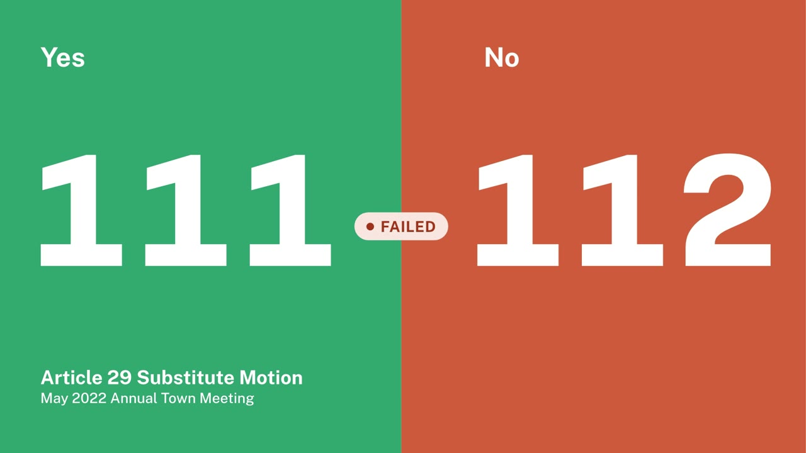

This repo has apps and data related to Brookline's Town Meeting.

▶ [Watch the 43-second promo](https://brooklinetownmeeting.org/TMpromo.mp4) · [Open the app](https://brooklinetownmeeting.org)

TMMvotes.html is a web app for tracking Town Meeting member (TMM) votes at Town Meeting. 
TMMpca.html is a web app for principal component analysis (PCA) on TMM votes.
The /Votes folder has data on all Town Meeting votes from 2021-2026 (13 sessions).

This project is licensed under the MIT License.